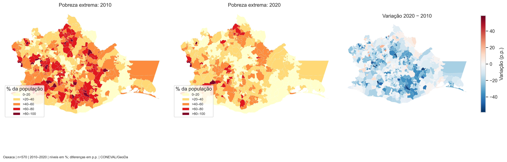
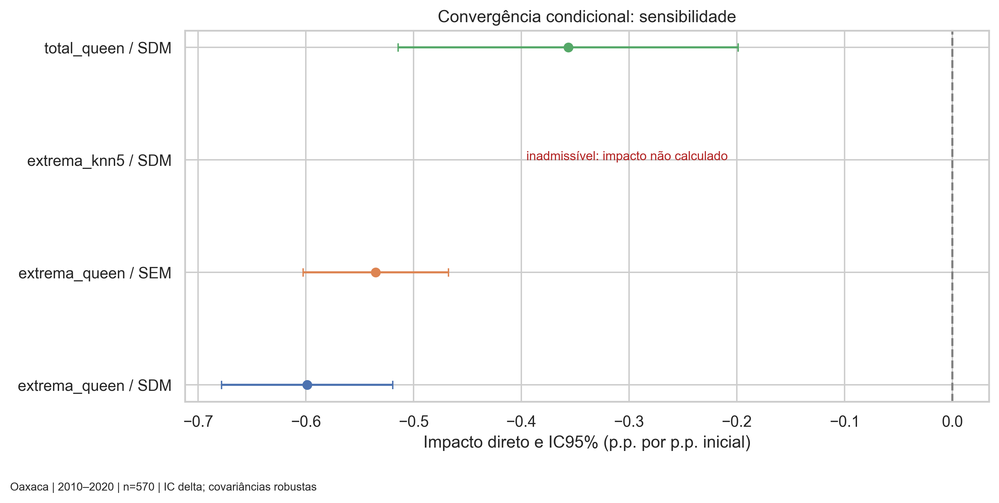

# Armadilhas espaciais de pobreza em Oaxaca

## Resumo

O projeto examina se os municípios inicialmente mais pobres de Oaxaca tiveram maiores reduções da pobreza entre 2010 e 2020, avaliando a convergência condicional e a dependência espacial nos 570 municípios. A análise exploratória mostrou queda da média municipal da pobreza extrema de 43,49% para 28,71%, com trajetórias heterogêneas e associação espacial positiva dos níveis e das mudanças. As modelagens indicaram associação direta de convergência sob Queen, com transbordamentos inconclusivos para pobreza extrema e positivos para pobreza total, enquanto a diferença específica de convergência entre regimes permaneceu incerta. A avaliação dos diagnósticos apontou o SEM/Queen como candidato provisório para interpretar a pobreza extrema e o SDM/Queen como a especificação mais sustentada para pobreza total. As limitações incluem erros de mensuração, regressão à média, sensibilidade à vizinhança e restrições de diagnóstico e identificação, tendo como próximos passos avaliar formalmente as inovações do SEM e buscar uma estratégia de identificação com exclusão instrumental defensável.

## 1. Introdução

A pobreza extrema caiu entre 2010 e 2020 em Oaxaca, no México, mas a intensidade da mudança variou entre municípios. A proximidade territorial pode reunir municípios com condições iniciais semelhantes e trajetórias relacionadas. Por isso, a queda média deixa em aberto se os municípios que partiram das taxas mais altas avançaram mais e como as condições dos vizinhos se relacionam com esse avanço.

Diante disso, surge a questão da pesquisa: entre os 570 municípios de Oaxaca, níveis mais altos de pobreza extrema em 2010 estiveram associados a quedas maiores até 2020, dadas as condições locais? Como a estrutura de vizinhança se relaciona com essa mudança?

O objetivo é avaliar a convergência condicional da pobreza extrema e examinar a dependência espacial da mudança. A análise também compara a pobreza total e verifica se a convergência varia entre grupos de municípios definidos pela proporção de falantes de língua indígena. O arquivo com a [proposta de pesquisa](docs/Proposta_Projeto_Pobreza_Oaxaca.pdf) apresenta maiores detalhes.

As hipóteses são: (1) a convergência condicional, com maior pobreza inicial associada a uma mudança posterior mais negativa; (2) a armadilha espacial, com condições desfavoráveis nos vizinhos associadas a uma redução local menor; (3) a interação espacial positiva, com associação entre as mudanças local e dos vizinhos em uma especificação admissível; e (4) a hipótese de heterogeneidade, que examina a diferença no coeficiente inicial entre regimes definidos pelo limiar de 50% de falantes de língua indígena.

## 2. Metodologia

### Dados e variáveis

A base reúne indicadores de pobreza do Consejo Nacional de Evaluación de la Política de Desarrollo Social (CONEVAL), em português, Conselho Nacional de Avaliação da Política de Desenvolvimento Social, além de informações censitárias do Instituto Nacional de Estadística y Geografía (INEGI) em português, Instituto Nacional de Estatística e Geografia, e a malha municipal, distribuídos pelo GeoDa.

A amostra cobre os 570 municípios, com os mesmos casos nas três análises. O resultado investigado é a taxa municipal de pobreza extrema em 2020 menos a de 2010, em pontos percentuais, em que valores negativos correspondem a reduções. Os dados estão disponíveis [aqui](https://geodacenter.github.io/data-and-lab/Oaxaca-Development/).

A análise principal considera a pobreza extrema. Para verificar se os resultados também se sustentam ao considerar a pobreza total, que inclui as pessoas em pobreza moderada e extrema, repete-se a análise usando a taxa de pobreza total em 2010 e sua variação entre 2010 e 2020, em substituição às medidas correspondentes de pobreza extrema.

Os controles incluem a taxa inicial do desfecho, anos médios de estudo, proporção de falantes de língua indígena, acesso à saúde, logaritmo da população e altitude. As condições socioeconômicas são de 2010. A altitude média das localidades de 2020 serve como aproximação geográfica fixa. A unidade em metros é inferida da convenção do INEGI. O [dicionário analítico](data/processed/dicionario_analitico.csv) apresenta a descrição das variáveis.

A auditoria confronta códigos e atributos do GeoJSON com o Shapefile, verifica faixas e denominadores e registra a procedência por SHA-256. Sete geometrias foram reparadas na base tratada, com preservação das ligações Queen. Os 570 municípios entraram por casos completos. Há arquivos sobre a [auditoria](outputs/tables/auditoria_dados.csv) feita, os [reparos](outputs/tables/reparos_geometrias.csv) aplicados e, por fim, a [base tratada](data/processed/oaxaca_analise.gpkg).

### Procedimentos metodológicos

#### 1. Conferência, tratamento e definição da amostra

O primeiro notebook ordena os códigos municipais textuais e confronta os atributos usados nos dois formatos geográficos. A auditoria verifica ausências, valores finitos, faixas dos percentuais, população positiva e fórmulas de numerador e denominador. Os sete reparos geométricos são conferidos pela validade final, pela correspondência com o Shapefile e pela preservação dos conjuntos de vizinhos Queen. O registro por hash permite identificar os arquivos de origem e conferir sua integridade ao final.

São construídas as diferenças entre 2020 e 2010, o logaritmo da população de 2010, os regimes e os indicadores de casos completos. A amostra comum de 570 municípios é mantida nas análises de pobreza extrema e total. O segundo notebook lê exclusivamente a base tratada como entrada de dados municipais, reconfere as fórmulas e reconstrói as matrizes na ordem dos códigos.

#### 2. Vizinhança e análise exploratória espacial

A Queen conecta municípios que compartilham borda ou vértice. A KNN-5 conecta cada município aos cinco centroides mais próximos, calculados em EPSG:6372, em metros. As matrizes têm diagonal zero e são padronizadas por linha, de modo que a defasagem espacial representa uma média ponderada dos vizinhos. Conferem-se ilhas, componentes e assimetria, preservando as ligações direcionadas da KNN. A [tabela](outputs/tables/resumo_pesos.csv) mostra o resumo dos pesos.

As estatísticas, distribuições e mapas atribuem pesos iguais aos municípios. Os mapas de nível compartilham classes entre anos e os de mudança usam uma escala centrada em zero. O Moran global e o local são calculados para a pobreza extrema em 2010, em 2020 e para sua mudança, com ambas as matrizes, 999 permutações e semente 42. O roteiro distingue o p-valor empírico de permutação do p-valor normal bilateral. Os mapas LISA usam corte nominal de 5% e leitura exploratória, sem correção por testes múltiplos. Com isso, gera-se tabelas com [Moran global](outputs/tables/moran_global.csv) e [LISA municipal](outputs/tables/lisa_municipal.csv).

#### 3. MQO e diagnósticos iniciais

No segundo notebook, o ponto de partida é a regressão da mudança da pobreza sobre sua taxa inicial e as condições municipais. Para cada desfecho, define-se:

$$
\Delta P_i=P_{i,2020}-P_{i,2010},
\qquad
\Delta P=\alpha\mathbf{1}+X\beta+\varepsilon.
$$

O vetor de resposta está em p.p. e X contém seis regressores, excluindo o intercepto. São a pobreza inicial do desfecho, escolaridade média, proporção de falantes de língua indígena, acesso à saúde, logaritmo da população e altitude. Estima-se MQO com covariância White, comparando a mesma especificação de pobreza extrema sob Queen e KNN-5 e a de pobreza total sob Queen. Os coeficientes de MQO estão [aqui](outputs/tables/coeficientes_mqo.csv).

O número de condição avalia o condicionamento dos regressores. O teste Jarque–Bera examina normalidade residual, enquanto Breusch–Pagan, Koenker–Bassett e White examinam heterocedasticidade. O teste White usa regressores padronizados somente na regressão auxiliar. O Moran residual utiliza os momentos próprios da regressão. A covariância White ajusta a inferência dos coeficientes à heterocedasticidade, e os testes de especificação conservam seus pressupostos próprios. Os diagnósticos de MQO estão [aqui](outputs/tables/diagnosticos_mqo.csv).

#### 4. Seleção STGE-Pre

A sequência começa pelo teste LM-WX, que verifica se há evidência para incluir no modelo as características dos municípios vizinhos, além das características do próprio município. Quando esse rejeita a hipótese de ausência de termos associados às características dos municípios vizinhos, segue-se para os testes do ramo Durbin, que ajudam a definir como essas relações espaciais devem entrar no modelo.

Nesse ramo, o teste conjunto investiga a necessidade de Wy e WX e os testes robustos distinguem a contribuição de cada componente diante do outro. A rejeição conjunta e dos dois robustos sustenta a indicação de SDM encontrada nas três combinações do projeto. Se LM-WX deixasse de rejeitar, a revisão passaria ao ramo clássico de lag e erro e aos respectivos testes robustos. As trajetórias de seleção encontram-se [aqui](outputs/tables/trajetoria_stge.csv).

#### 5. Estimação do SDM e identificação de Wy

O modelo Durbin espacial incorpora a mudança da pobreza dos vizinhos e suas condições iniciais:

$$
\Delta P=\rho W\Delta P+\alpha\mathbf{1}+X\beta+WX\theta+\varepsilon.
$$

W é a matriz padronizada, Wy corresponde a WΔP, rho mede o componente autorregressivo e theta reúne os parâmetros dos seis regressores defasados. A defasagem do desfecho é tratada como endógena. Os SDM são estimados por mínimos quadrados em dois estágios espaciais (MQ2E), com covariância White. A matriz WX contém os regressores exógenos defasados e os instrumentos excluídos para Wy são as seis colunas de W²X. Os coeficientes espaciais estão [aqui](outputs/tables/coeficientes_modelos.csv).

Confere-se o posto de H, a matriz de regressores exógenos e instrumentos, e de HᵀZ, em que Z contém os regressores da equação, incluindo Wy. A primeira etapa é reestimada com covariância HC0 para o teste Wald conjunto dos instrumentos excluídos. O R² parcial compara as regressões completa e restrita. Posto suficiente estabelece identificação algébrica, enquanto a relevância e a plausibilidade da exogeneidade exigem avaliações próprias. Wald dividido pelo número de instrumentos é apresentado como diagnóstico, sem um limiar universal de força. [Aqui](outputs/tables/instrumentos_wy.csv) estão os instrumentos de Wy.

#### 6. Admissibilidade, diagnóstico espacial e comparação com SEM

O projeto adota o intervalo de estabilidade −1 < rho < 1 para calcular impactos do SDM. A tentativa pobreza extrema/KNN-5 fica fora dessa região e é registrada com impactos ausentes. Nos SDM admissíveis, Anselin–Kelejian (AK) examina dependência residual após MQ2E. O teste de fator comum avalia a restrição theta = −rho beta, sob a qual a representação Durbin pode ser reduzida a um modelo de erro espacial. Os diagnósticos espaciais estão presentes [aqui](outputs/tables/diagnosticos_modelos.csv).

Para pobreza extrema com Queen, a não rejeição dessa restrição permite estimar o SEM por GMM robusto à heterocedasticidade:

$$
\Delta P=\alpha\mathbf{1}+X\beta+u,
\qquad
u=\lambda Wu+\varepsilon.
$$

Lambda descreve a dependência no erro e beta representa a associação local condicionada aos controles. As inovações são obtidas por $\hat\varepsilon=(I-\hat\lambda W)\hat u$, em que $\hat u$ é o resíduo da equação. Seu Moran é examinado descritivamente, pois o roteiro carece de um teste inferencial residual compatível com o GMM heterocedástico. A avaliação compara admissibilidade, diagnóstico, identificação e incerteza. A covariância robusta e o pseudo-R², isoladamente, são insuficientes para decidir a adequação espacial.

#### 7. Impactos completos e incerteza

Nos SDM admissíveis, a resposta a cada regressor considera os retornos pela rede. Para o regressor k, calcula-se:

$$
M_k=(I-\rho W)^{-1}(\beta_k I+\theta_k W).
$$

O impacto direto médio é a média da diagonal de $M_k$, o total médio é a média das somas de suas linhas e o indireto é a diferença entre total e direto. O método delta propaga a covariância conjunta de beta, theta e rho para obter erros-padrão, p-valores e intervalos próprios dos impactos. No SEM, a comparação usa os coeficientes locais e seus intervalos. Cada regressor conserva sua unidade original. Esse [aquivo](outputs/tables/impactos_modelos.csv) resume os impactos e intervalos.

#### 8. Comparações de robustez e extensões

A comparação do núcleo reúne extrema/Queen, extrema/KNN-5 e total/Queen, além do SEM extrema/Queen. A mudança de desfecho substitui também a pobreza inicial e conserva os cinco controles e a amostra. A interpretação distingue estabilidade do sinal da associação, admissibilidade e diagnóstico da especificação. [Aqui](outputs/tables/comparacao_robustezes.csv) estão os resultados da comparação das robustezes.

Nos regimes, o corte de 50% permite variar intercepto e parâmetros locais e, no SDM, contextuais. WX é calculado antes das interações com o grupo receptor, mantendo as ligações entre grupos e um parâmetro espacial comum. São estimados SDM por MQ2E White e SEM por GMM heterocedástico. O Wald conjunto testa o indicador e todas as interações, enquanto o contraste de H4 testa a diferença do coeficiente inicial. Ambos usam a covariância completa do estimador. Os testes por regimes estão [aqui](outputs/tables/regimes_h4.csv).

A sigma-convergência compara o desvio-padrão amostral e o intervalo interquartil das taxas nos mesmos municípios em 2010 e 2020, com pesos iguais e leitura descritiva. A extensão instrumental audita os indicadores de 2000 e avalia sua relevância para a pobreza inicial por primeira etapa HC0. A decisão de avançar à segunda etapa depende também da justificativa substantiva de exclusão. Os seguintes arquivos contém os resultados sobre [dispersão](outputs/tables/sigma_convergencia.csv), [relevância instrumental](outputs/tables/relevancia_instrumentos_2000.csv) e [viabilidade](outputs/tables/viabilidade_instrumentos_2000.csv).

### Execução dos notebooks

O projeto foi desenvolvido em Python, na versão 3.14.3. A execução funciona a partir da raiz ou de `src/`:

1. [Tratamento e exploração](src/01_tratamento_analise_exploratoria.ipynb): prepara os dados, descreve a evolução da pobreza e identifica padrões e agrupamentos espaciais nos municípios de Oaxaca;
2. [Estimação, robustez e extensões](src/02_especificacao_estimacao_robustez.ipynb): estima modelos para investigar a convergência da pobreza e suas relações espaciais, verifica a robustez dos resultados e examina diferenças entre grupos de municípios.

Os notebooks apresentam resultados no console com resumos nativos dos estimadores, como `print(modelo.summary)`, e impressões identificadas de estatísticas, p-valores e intervalos. Cada análise e cada figura é seguida de interpretação em Markdown. Os modelos, matrizes e gráficos usam blocos explícitos. Os laços técnicos conferem arquivos e dados e localizam a raiz do projeto. As exportações mantêm 22 CSVs de resultados e auditoria e 17 figuras.

## 3. Resultados

### 3.1 Análise exploratória

Figura 1 - Pobreza extrema municipal em Oaxaca

Os dois mapas de nível compartilham as classes. O terceiro mostra a diferença em pontos percentuais. A média municipal sem ponderação populacional caiu de 43,49% para 28,71%, ou 14,78 p.p. Houve queda em 505 municípios, aumento em 62 e estabilidade em três. Com Queen, o Moran global caiu de 0,500 em 2010 para 0,433 em 2020 e foi de 0,255 para a mudança. Os três resultados têm p de permutação de 0,001. A associação espacial é mais forte nos níveis do que na mudança. Os mapas LISA localizam agrupamentos exploratórios com significância nominal, sem ajuste por testes múltiplos.

O número de municípios com pobreza extrema acima de 60% caiu de 150 para 25. A mudança média resume um movimento amplo, mas a faixa de −58,8 a +37,3 p.p. mostra trajetórias muito diferentes. Como a unidade é o município e cada um recebe o mesmo peso, os números descrevem a distribuição territorial. A taxa estadual exigiria ponderação pela população de referência.

A KNN-5 também apresenta associação espacial positiva nos dois níveis e na mudança, com Moran de 0,560, 0,466 e 0,268. O padrão exploratório aparece sob as duas definições de vizinhança. Ainda assim, elas conectam municípios diferentes. A Queen tem de 1 a 22 vizinhos, enquanto a KNN-5 mantém cinco e inclui 680 ligações direcionadas sem recíproca. Essas características ajudam a contextualizar a sensibilidade da estimação posterior.

Com Queen, 191 municípios apresentam indicação LISA nominal em 2010 e 172 em 2020. Para a mudança, são 136, dos quais 66 estão em alto–alto e 43 em baixo–baixo. Na mudança, baixo–baixo representa valores abaixo da média municipal, compatíveis com reduções mais intensas, enquanto alto–alto pode reunir quedas menores que a média. As classificações devem ser lidas em relação à variável e ao ano representados.

Para pobreza total, a média municipal caiu de 82,08% para 77,32%, uma redução de 4,75 p.p. Os controles também mostram heterogeneidade, com escolaridade entre 2,32 e 11,82 anos e participação de falantes de língua indígena entre 0 e 99,75%. Esses padrões motivam condicionar a comparação das trajetórias às condições iniciais observadas.

### 3.2 Modelagem

#### Seleção e estimação

A seleção STGE-Pre indicou SDM nas três combinações. Em extrema/Queen, LM-WX tem p = 0,000335, o conjunto Durbin tem p aproximado de 2,33 × 10⁻⁹ e os robustos WX e lag têm p aproximados de 3,00 × 10⁻⁶ e 7,32 × 10⁻⁸. A rejeição dos dois componentes justifica a estimação inicial do SDM, cujo desempenho é confrontado com os diagnósticos posteriores.

Para pobreza extrema com Queen, o teste Anselin–Kelejian (AK) apontou dependência residual no SDM (p = 0,0132). O teste de fator comum não rejeitou a restrição compatível com o SEM (p = 0,4265), permitindo sua estimação e comparação. O Moran das inovações do SEM ficou próximo de zero (I = −0,0153), com avaliação descritiva após o GMM.

#### Estimativas e impactos

Figura 2 - Associação direta em pontos percentuais da mudança por ponto percentual de pobreza inicial

Os pontos representam o impacto direto médio no SDM e a associação local no SEM. Para pobreza extrema com Queen, as estimativas diretas foram −0,599 no SDM e −0,535 no SEM. Seus intervalos ficaram inteiramente abaixo de zero. O SDM com KNN-5 produziu rho de 1,276, fora da região de estabilidade adotada, e por isso aparece sem impacto. Para pobreza total, o impacto direto inicial foi −0,357, com IC95% de −0,514 a −0,199. O impacto indireto da pobreza inicial foi positivo para pobreza total (0,548, IC95% de 0,254 a 0,843) e impreciso para pobreza extrema (0,588, IC95% de −0,778 a 1,955). [Comparação das estimativas](outputs/tables/comparacao_robustezes.csv)

#### Adequação dos modelos e evidências de robustez

Para pobreza extrema, o SEM/Queen é o candidato mais defensável para interpretar a convergência, com indicação provisória. Sua estimação acomoda heterocedasticidade e o coeficiente inicial tem intervalo inteiramente negativo. A não rejeição do fator comum permite considerar essa representação mais parcimoniosa diante do AK adverso do SDM/Queen. O Moran das inovações de −0,0153 acrescenta evidência descritiva favorável. A ausência do teste formal pós-GMM limita a conclusão sobre adequação residual.

Para pobreza total, o SDM/Queen é a especificação mais sustentada pelo procedimento aplicado. Rho é 0,4528 e está na região estável adotada, o AK tem p = 0,1985 e o fator comum tem p = 0,000928. Assim, o teste residual não rejeita a 5% e a redução ao SEM é rejeitada. Os seis instrumentos excluídos têm posto suficiente e relevância conjunta, com Wald HC0 de 25,40 e p = 0,000288, R² parcial de 0,1201 e Wald/q de 4,23. Essa primeira etapa e os pressupostos do AK continuam condicionando a avaliação, inclusive quanto à força dos instrumentos e à sua exogeneidade.

A robustez à matriz de vizinhança permanece limitada. O SDM extrema/KNN-5 estima rho = 1,2758, fora da região estável, o que impede impactos admissíveis. Seu R² parcial dos instrumentos é 0,0523 e Wald/q é 4,62. No SDM extrema/Queen, esses valores são 0,0794 e 7,61. Os resultados exploratórios positivos nas duas redes convivem, portanto, com sensibilidade adversa na estimação estrutural.

A evidência mais estável entre as especificações Queen é a associação direta negativa da pobreza inicial. A sustentação dos transbordamentos e dos mecanismos espaciais depende do desfecho e dos diagnósticos. O pseudo-R² é 0,622 no SDM extrema/Queen e 0,577 no SEM, mas a maior correlação de ajuste do SDM convive com o AK adverso. A avaliação de robustez considera conjuntamente essas dimensões.

#### Discussão das hipóteses

**H1 - Convergência condicional**: As duas especificações Queen indicam que maior pobreza extrema inicial esteve associada a reduções posteriores maiores, resultado compatível com convergência condicional. No SEM, cada ponto percentual adicional de pobreza em 2010 correspondeu a uma queda adicional de aproximadamente 0,54 p.p. no decênio, enquanto um ano adicional de escolaridade média esteve associado a uma redução adicional de 3,29 p.p. Maiores proporções de falantes de língua indígena e de acesso à saúde apresentaram associações positivas com a mudança, indicando reduções menores, mantidas as demais variáveis constantes. Os resultados são associativos e devem ser interpretados considerando possíveis erros de mensuração, diferenças de composição e fatores omitidos.

**H2 - Armadilha espacial**: Para pobreza extrema, a estimativa indireta positiva da taxa inicial é compatível com redução local menor diante de maior pobreza inicial nos demais municípios conectados pelo multiplicador espacial. Seu intervalo, porém, abrange valores negativos e positivos. O impacto total também é impreciso, com estimativa de −0,011 e IC95% de −1,376 a 1,354. Assim, o projeto encontra uma associação direta de convergência mais precisa que a evidência de transbordamentos da pobreza inicial. O coeficiente de WX participa desses impactos juntamente com rho e os retornos pela rede.

**H3 - Interação espacial positiva**: O SDM extrema/Queen estima rho positivo, de 0,831, mas o AK adverso indica que a especificação ainda deixa dependência nos resíduos. A tentativa KNN-5 tem rho de 1,276 e perde admissibilidade. O Moran exploratório positivo mostra semelhança territorial que também pode refletir fatores compartilhados. Diante dos diagnósticos, a hipótese de interação entre as trajetórias permanece inconclusiva para pobreza extrema. O SEM acomoda dependência no erro, com lambda de 0,356, e a avaliação das suas inovações fica restrita à evidência descritiva disponível.

**H4 - Heterogeneidade da convergência**: Os grupos têm 348 e 222 municípios. No SDM por regimes, os coeficientes iniciais são −0,591 e −0,705, com diferença de −0,114 e p = 0,135. No SEM, são −0,499 e −0,544, com diferença de −0,044 e p = 0,482. Os dois contrastes incluem zero em seus intervalos de 95%. Os testes conjuntos rejeitam estabilidade dos parâmetros, com p = 0,000369 no SDM e aproximadamente 0,00000294 no SEM. A heterogeneidade conjunta pode envolver escolaridade, outros controles, intercepto e termos contextuais, enquanto a diferença específica de convergência permanece incerta.

## 4. Considerações

Entre os municípios de Oaxaca, maior pobreza extrema inicial esteve associada a uma queda posterior maior após condicionar pelos controles. A dispersão das taxas também recuou. A evidência de transbordamentos na pobreza extrema e de diferenças na convergência entre regimes permaneceu inconclusiva.

Para interpretar a convergência da pobreza extrema, o SEM/Queen é o candidato relativamente mais defensável, considerando o fator comum e o AK do SDM e a evidência descritiva das suas inovações. Essa preferência é provisória pela lacuna de diagnóstico formal pós-GMM. Para pobreza total, o SDM/Queen reúne os diagnósticos mais favoráveis à representação Durbin aplicada. A tentativa KNN-5 explicita o limite da estabilidade da estimação sob outra rede, e a comparação de impactos conserva a distinção entre associação direta de convergência e incerteza sobre transbordamentos.

As análises de sensibilidade mostram que as conclusões espaciais dependem do conceito de pobreza: na mesma amostra municipal, a pobreza total apresenta impacto indireto positivo e mais preciso, com diagnósticos distintos dos obtidos para pobreza extrema. A dispersão da pobreza extrema diminuiu, com reduções de 20,7% no desvio-padrão e de 26,7% no intervalo interquartil, indicando sigma-convergência, embora persistam municípios com taxas elevadas. Os indicadores de 2000 foram conjuntamente relevantes para explicar a pobreza inicial, mas seus possíveis efeitos diretos sobre a mudança posterior impediram justificar seu uso como instrumentos e avançar à segunda etapa da estimação.

As conclusões são associativas. Erros de mensuração e regressão à média podem afetar a relação entre o nível inicial e a mudança. A inferência é condicional às especificações selecionadas, e a comparação de modelos é limitada pela sensibilidade à matriz de vizinhança e pelas diferenças entre os diagnósticos disponíveis. Os testes LM e AK conservam seus pressupostos próprios mesmo quando os coeficientes usam covariância White. A relevância estatística dos indicadores de 2000, por si só, deixa em aberto a validade da exclusão.

Os próximos passos são avaliar formalmente a dependência nas inovações do SEM com um diagnóstico compatível com GMM heterocedástico e buscar uma estratégia de identificação com justificativa substantiva para a exclusão, ou um desenho que dispense essa hipótese.
